# 📊 CodeAlpha Data Science Internship — Task 4: Sales Prediction using Python


This repository contains the complete, beginner-friendly submission for **Task 4: Sales Prediction using Python** under the **CodeAlpha Data Science Internship program**.

---

## 📌 1. Project Overview & Problem Statement

In business and marketing operations, companies spend millions of dollars across multiple advertising platforms such as **Television (TV)**, **Radio**, and **Newspaper**. A core challenge faced by Chief Marketing Officers (CMOs) and business strategists is:

> *"How does advertising expenditure across various media channels affect product sales, and how can we accurately predict future sales to optimize marketing budget allocation?"*

### Project Goals
1. Inspect, clean, and validate the actual Advertising dataset.
2. Uncover relationships and correlations between advertising expenditure and sales.
3. Demonstrate categorical feature handling and encoding as required in real-world ML pipelines.
4. Train, evaluate, and compare multiple machine learning regression algorithms (**Multiple Linear Regression** and **Random Forest Regressor**).
5. Evaluate models using industry-standard regression metrics (**MAE**, **RMSE**, and **$R^2$**).
6. Provide actionable, data-backed business insights for marketing budget optimization.

---

## 📂 2. Dataset Information

The project analyzes the official **Advertising Dataset** (`Advertising.csv`), containing **200 records** of advertising expenditures and resultant product sales:

| Column Name | Data Type | Description | Unit of Measurement |
| :--- | :--- | :--- | :--- |
| `TV` | `float64` | Advertising budget spent on TV campaigns | Thousands of dollars ($1,000s) |
| `Radio` | `float64` | Advertising budget spent on Radio broadcasts | Thousands of dollars ($1,000s) |
| `Newspaper` | `float64` | Advertising budget spent on Newspaper print ads | Thousands of dollars ($1,000s) |
| `Sales` | `float64` | Total units sold of the product (Target Variable) | Thousands of units (1,000s) |

> **Note on Data Cleaning:** The raw CSV includes an initial indexing column (`Unnamed: 0`), which is dropped during preprocessing. No missing values or duplicate rows were found in the dataset.

---

## ⚙️ 3. Methodology & Workflow

The complete end-to-end data science pipeline consists of the following steps:

```mermaid
flowchart LR
    A["Raw Data (Advertising.csv)"] --> B["Data Cleaning & Inspection"]
    B --> C["Exploratory Data Analysis (EDA)"]
    C --> D["Categorical Encoding Demo"]
    D --> E["80/20 Train/Test Split"]
    E --> F["Model Training (Linear Reg & Random Forest)"]
    F --> G["Model Evaluation (MAE, RMSE, R²)"]
    G --> H["Diagnostics & Visualizations"]
    H --> I["Actionable Business Insights"]
```



1. **Data Ingestion & Cleaning:**
   - Removal of serial index column `Unnamed: 0`.
   - Comprehensive null-value verification and duplicate check.
   - Descriptive statistics generation.
2. **Exploratory Data Analysis (EDA):**
   - Univariate distributions (histograms with KDE curves).
   - Bivariate relationship scatter plots with regression trendlines.
   - Pearson correlation matrix heatmap.
3. **Categorical Feature Demonstration (Requirement #5):**
   - The primary dataset consists of continuous numerical spend features across platforms.
   - To illustrate real-world handling of categorical features (e.g., `Platform` or `Target_Segment`), we construct an engineered feature (`Dominant_Platform`) and perform **One-Hot Encoding** (`pd.get_dummies`).
4. **Data Splitting:**
   - Partitioned into **80% Training (160 samples)** and **20% Testing (40 samples)** using `random_state=42` for exact reproducibility.
5. **Model Building & Comparison:**
   - **Model 1: Multiple Linear Regression** — interpretable baseline model capturing linear slopes and baseline intercept.
   - **Model 2: Random Forest Regressor** — ensemble of 100 decision trees capturing non-linear interactions and diminishing returns.
6. **Model Evaluation:**
   - **MAE (Mean Absolute Error)**: average magnitude of prediction errors in actual units.
   - **RMSE (Root Mean Squared Error)**: penalizes large outlier errors.
   - **$R^2$ (Coefficient of Determination)**: proportion of sales variance explained by the model.

---

## 📊 4. Actual Model Performance & Results

All models were evaluated on the unseen 20% test dataset (40 observations). No numbers are fabricated or estimated:

| Model | MAE (Sales Units) | RMSE (Sales Units) | $R^2$ Score | Variance Explained (%) |
| :--- | :---: | :---: | :---: | :---: |
| **Multiple Linear Regression** | `1.4608` | `1.7816` | `0.8994` | `89.94%` |
| **Random Forest Regressor** | **`0.6203`** | **`0.7687`** | **`0.9813`** | **`98.13%`** |

### Key Regression Coefficients (Linear Regression)
$$\text{Sales} = 2.9791 + 0.0447 \times (\text{TV}) + 0.1892 \times (\text{Radio}) + 0.0028 \times (\text{Newspaper})$$

- **TV Coefficient (+0.0447):** Every additional $1,000 spent on TV increases sales by ~45 units when other channels remain constant.
- **Radio Coefficient (+0.1892):** Every additional $1,000 spent on Radio increases sales by ~189 units. Radio demonstrates the highest marginal return per dollar.
- **Newspaper Coefficient (+0.0028):** Negligible impact on sales; statistically insignificant when TV and Radio are considered.

### Feature Importances (Random Forest)
- **TV:** `62.48%`
- **Radio:** `36.22%`
- **Newspaper:** `1.30%`

---

## 📈 5. Visualizations & Diagnostic Charts

All high-resolution figures are generated automatically by running `main.py` or `sales_prediction.ipynb` and saved into the `results/` folder:

| Chart Filename | Description |
| :--- | :--- |
| `01_feature_distributions.png` | Histograms and KDE plots showing data distributions of TV, Radio, Newspaper, and Sales. |
| `02_advertising_vs_sales_scatter.png` | Scatter plots with fitted linear regression trendlines for each media channel against Sales. |
| `03_correlation_heatmap.png` | Annotated Pearson correlation matrix revealing inter-feature correlations. |
| `04_actual_vs_predicted_lr.png` | Scatter plot of Actual vs. Predicted Sales for Linear Regression against the ideal $y=x$ reference line. |
| `05_actual_vs_predicted_rf.png` | Scatter plot of Actual vs. Predicted Sales for Random Forest against the ideal $y=x$ reference line. |
| `06_model_comparison_metrics.png` | Comparative bar charts comparing MAE, RMSE, and $R^2$ scores between models. |
| `07_feature_importance.png` | Side-by-side comparison of Linear Regression slopes vs. Random Forest feature importance percentages. |
| `08_residual_analysis.png` | Residuals vs. Fitted values and residual density distribution plots for error diagnostics. |

---

## 💡 6. Actionable Business Marketing Insights

Based on empirical data analysis and model evaluation, here are key recommendations for marketing leadership:

1. **TV is the Core Driver of Volume:**
   - TV spend exhibits the highest overall correlation with sales ($r = 0.782$) and accounts for over 62% of Random Forest importance. Companies needing high absolute volume and brand awareness must maintain substantial TV advertising.
2. **Radio Delivers the Highest Return Per Dollar (Marginal ROI):**
   - Radio's linear coefficient ($0.1892$) is over **4x higher** than TV ($0.0447$). An additional $10,000 allocated to radio yields approximately 1,892 extra unit sales. Radio is extremely capital-efficient.
3. **Reallocate Newspaper Advertising Budget:**
   - Newspaper advertising shows near-zero direct correlation with sales growth ($+0.0028$ coefficient, only $1.3\%$ importance). Reallocating print newspaper budgets into TV, radio, or digital advertising will immediately increase total marketing ROI without hurting sales.
4. **Leverage Cross-Channel Synergy:**
   - The Random Forest model achieved an exceptional $R^2$ of **0.9813** (reducing MAE by 57% compared to Linear Regression). This confirms that advertising channels do not act in isolation: combining TV brand exposure with high-frequency Radio reminders creates a compounding, non-linear multiplier effect on consumer purchases.

---

## 📁 7. Repository Structure

```text
CodeAlpha_Task_4—Sales_Prediction_using_Python/
│
├── Advertising.csv                   # Clean dataset with advertising spend and sales
├── main.py                           # Full automated Python script executing pipeline
├── sales_prediction.ipynb            # Interactive, executed Jupyter Notebook with visual outputs
├── requirements.txt                  # Python dependencies
├── build_notebook.py                 # Script used to compile and format the notebook
├── README.md                         # Project documentation and submission report
│
└── results/                          # Output directory for exported charts and tables
    ├── 01_feature_distributions.png
    ├── 02_advertising_vs_sales_scatter.png
    ├── 03_correlation_heatmap.png
    ├── 04_actual_vs_predicted_lr.png
    ├── 05_actual_vs_predicted_rf.png
    ├── 06_model_comparison_metrics.png
    ├── 07_feature_importance.png
    ├── 08_residual_analysis.png
    ├── business_insights.txt
    └── model_metrics_summary.csv
```

---

## 🚀 8. How to Setup and Run the Project

### Prerequisites
- Python 3.9 or higher installed on your computer.

### Step 1: Clone or Navigate to the Project Directory
```bash
cd "d:/New folder/CodeAlpha_Task_4—Sales_Prediction_using_Python"
```

### Step 2: Install Dependencies
```bash
pip install -r requirements.txt
```

### Step 3: Run the Complete Pipeline
```bash
python main.py
```
This will:
- Inspect and clean the dataset.
- Generate and save all 8 visualization charts into the `results/` folder.
- Train and evaluate both Linear Regression and Random Forest models.
- Print detailed model metrics and business insights to the terminal.
- Export `model_metrics_summary.csv` and `business_insights.txt`.

### Step 4: Open and Explore the Jupyter Notebook
```bash
jupyter notebook sales_prediction.ipynb
```

---

## 📌 9. CodeAlpha Internship Submission Instructions

To submit this project successfully to CodeAlpha:
1. **GitHub Repository**:
   - Create a GitHub repository named `CodeAlpha_Sales_Prediction` or `CodeAlpha_Task4_SalesPrediction`.
   - Push all project files (`Advertising.csv`, `main.py`, `sales_prediction.ipynb`, `requirements.txt`, `README.md`, and the `results/` folder).
2. **LinkedIn Post**:
   - Record a 2 to 3-minute video walkthrough explaining:
     - The business problem (optimizing advertising budgets).
     - Exploratory Data Analysis and findings (TV vs. Radio vs. Newspaper).
     - Model comparison (Linear Regression vs. Random Forest).
     - Business recommendations for CMOs.
   - Post the video on LinkedIn tagging **@CodeAlpha** with your GitHub repository link.
3. **Submission Form**:
   - Fill out the official CodeAlpha task submission form shared in your WhatsApp group with your GitHub URL and LinkedIn post link.

---
*Created as part of the CodeAlpha Data Science Internship program.*

